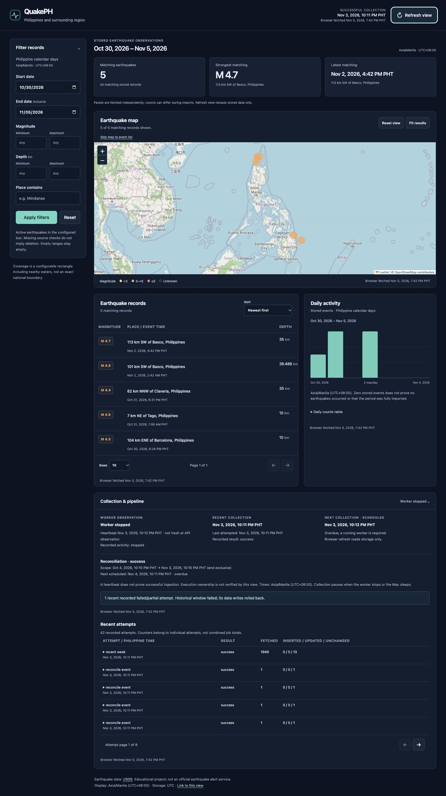
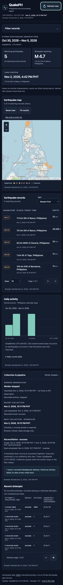

# QuakePH — Milestones 1–6

A student data engineering project covering **Philippines and surrounding region**
(4–22° latitude, 116–130° longitude). This configurable rectangle includes nearby
waters; it is not an exact national boundary.

Recent ingestion, resumable historical imports, scheduled collection, reconciliation,
and compact revision history are implemented. Read-only dashboard APIs now expose
stored events, statistics, and pipeline health. PostgreSQL persists events, attempts,
checkpoints, schedules, and worker health. The responsive dashboard adds a Leaflet
map, searchable event table, daily chart, event details, and pipeline observations.
No fixtures are inserted into the running application.

## How the pieces fit

- `backend/app/`: FastAPI serves HTTP endpoints; SQLAlchemy connects to PostgreSQL.
- `backend/alembic/`: Alembic tracks database schema versions. The baseline revision
  is followed by earthquake storage, pipeline runs, and historical job/window tables.
- `backend/tests/`: pytest checks health behavior and configuration validation.
- `frontend/`: React + TypeScript + Vite displays the interactive read-only dashboard.
  Vite forwards `/api` and `/health` requests to the backend during development.
- `compose.yaml`: runs PostgreSQL 17 with a persistent local Docker volume.

PostgreSQL connections use UTC. All event and run timestamps use timezone-aware
`TIMESTAMP WITH TIME ZONE` columns. The dashboard formats event and observation times explicitly in
Asia/Manila (UTC+08:00). Database credentials stay on the backend.

## Setup (macOS/Linux)

Requirements: Docker Desktop with its engine running, Python 3.9+ for the tooling
bootstrap, and Node 22.12+ (Node 24 LTS recommended). uv installs Python 3.12 for
the application, so the system Python does not need upgrading.

Run from the project root:

```sh
cd /Users/rich/Documents/Development/QuakePH
python3 -m venv .tools
.tools/bin/python -m pip install uv==0.13.6
.tools/bin/uv python install 3.12
[ -f .env ] || cp .env.example .env
.tools/bin/uv sync --directory backend --locked
npm --prefix frontend ci
```

Edit the private `.env` if desired. Keep `DATABASE_URL` consistent with the
`POSTGRES_*` values (URL-encode special characters in URL credentials). If you
change `POSTGRES_PORT`, update the URL port too. `.env` is ignored by Git. The
example password is only for this loopback-bound local development database.
PostgreSQL initialization settings apply when its data volume is first created;
changing `.env` does not change an existing database user's password. The example
now uses host port **55432**, matching the verified local configuration.

Start Docker Desktop, then:

```sh
docker compose up -d --wait
.tools/bin/uv run --directory backend --locked alembic upgrade head
.tools/bin/uv run --directory backend --locked alembic current
```

In terminal 1, from the project root:

```sh
.tools/bin/uv run --directory backend --locked uvicorn app.main:app --reload --host 127.0.0.1 --port 8001
```

In terminal 2, from the project root:

```sh
npm --prefix frontend run dev
```

Open <http://127.0.0.1:5174> and API docs at <http://127.0.0.1:8001/docs>.
Port 5174 is intentional because 5173 was already occupied on the development
machine. Port 8001 avoids another application on 8000. If 8001 or 5174 is occupied, stop the relevant process or update the Vite
port/proxy configuration consistently. `npm run preview` only previews static
build output and does not provide the development API proxy.

## Check it works

```sh
curl -i http://127.0.0.1:8001/health/live
curl -i http://127.0.0.1:8001/health/ready
curl -s http://127.0.0.1:5174/api/config
docker compose ps
.tools/bin/uv run --directory backend --locked pytest
npm --prefix frontend run build
npm --prefix frontend run lint
```

- `/health/live`: HTTP 200 means the Python process answers requests, even if the
  database is down.
- `/health/ready`: HTTP 200 means a real `SELECT 1` succeeded; HTTP 503 means the
  database is unavailable. It checks connectivity, not migration currency. Use
  `alembic current` to confirm `74ef76e7aa5e (head)` separately.
- The dashboard shows stored records for the latest seven Philippine calendar days.
  Empty dates are valid. Use **Refresh view** to reload stored data and pipeline status.
  Database readiness is checked separately through `/health/ready`.
- To observe the difference, run `docker compose stop db`, check both health URLs,
  then run `docker compose up -d --wait` and refresh the browser.

Stop web servers with Ctrl+C. `docker compose down` stops PostgreSQL while keeping
its named data volume. Do not remove the volume if you need its data.

## Milestone 1 verification record

Passed: dependency resolution with `backend/uv.lock` and `frontend/package-lock.json`,
8 pytest tests, TypeScript/production build, frontend lint, Compose configuration
validation, Alembic offline SQL generation and revision discovery, live HTTP 200
for liveness and HTTP 503 for unavailable database, and browser rendering with
configuration loaded through Vite's proxy.

Completed remaining Milestone 1 verification on **2026-10-27, Asia/Manila
(UTC+08:00)** against a real PostgreSQL 17 container:

- Started Docker Desktop; `docker info` reported Engine 29.4.1.
- `docker compose up -d --wait` started a healthy database. Port 5432 was
  occupied, so the ignored local `.env` uses `POSTGRES_PORT=55432` and a matching
  `DATABASE_URL` port. The committed Compose configuration and lockfiles are unchanged.
- `alembic upgrade head` succeeded online; `alembic current` and a direct query
  of `alembic_version` both confirmed `0001_baseline` at head.
- The running backend returned HTTP 200 for `/health/live` and `/health/ready`;
  readiness returned `{"status":"ready","database":"ok"}`. The Vite proxy
  also returned readiness HTTP 200.
- Browser inspection confirmed the exact text **API and database ready** and
  an explicit Asia/Manila (UTC+08:00) check-time label.
- Created the isolated, disposable table
  `public.quakeph_m1_persistence_verification` with row
  `(1, 'milestone1-persistence-20261027')`. Ran
  `docker compose up -d --force-recreate --wait db`; the container ID changed
  from `455121069a7d…` to `5ae02e7bd09e…` while its mounted volume remained
  `quakeph_postgres_data`. The exact row survived. Dropped the verification
  table and confirmed `to_regclass(...) IS NULL` returned true.
- `SHOW timezone` returned `UTC`.
- Ran `docker compose stop db`: liveness remained HTTP 200 and readiness
  returned HTTP 503 with `{"status":"not_ready","database":"unavailable"}`.
  Restored PostgreSQL using `docker compose up -d --wait db`, confirmed healthy
  status, and rechecked both endpoints: HTTP 200. Alembic remained at head.

No remaining blockers for Milestone 1. No volume was deleted, and
`docker compose down -v` was never run. No application code or dependency
lockfiles changed during this verification. The original passing test run emitted
an installed Starlette/httpx TestClient deprecation warning; it was non-failing.

The supplied GitHub repository is configured as the local `origin` remote:
`https://github.com/ragna0112/QuakePH.git`. Local commits do not imply a push.

## Milestone 2: ingestion and storage

From the project root, preserving your existing private `.env` and port 55432:

```sh
.tools/bin/uv sync --directory backend --locked
docker compose up -d --wait
.tools/bin/uv run --directory backend --locked alembic upgrade head
.tools/bin/uv run --directory backend --locked alembic current
.tools/bin/uv run --directory backend --locked python -m app.ingestion
```

Run the ingestion command again whenever you want to refresh the rolling week.
It prints the run UUID, status, counters, and error details. Exit code 0 means
success; partial or failed runs exit 1. This is a manual command, not a scheduler.
`httpx` moved from the development group to runtime dependencies at its existing
locked version; no installed package versions were upgraded.

A USGS feature becomes a row like this: fetch the real weekly GeoJSON, validate
its envelope and features, read coordinates as **longitude, latitude, depth in
kilometers**, convert integer epoch milliseconds to UTC, filter valid earthquake
features to the inclusive configured box, and write them in one database
transaction. Null magnitude, place, magnitude type, review status, and URL are
allowed. Valid negative magnitude/depth are accepted. ID, times, event type,
and finite coordinates/depth are required. Unknown extra properties remain in
`raw_event`, which holds the latest accepted complete feature.

The USGS ID is the primary key. PostgreSQL `ON CONFLICT DO NOTHING` safely
handles concurrent inserts; a conditional UPDATE replaces content only when the
incoming source-updated time is strictly newer. Identical and older revisions
preserve content/raw JSON and first-seen time, while last-seen advances using the
greatest observed UTC time. Rows missing from a later rolling feed are retained.

### Inspect data

Open a PostgreSQL prompt without putting credentials in shell arguments:

```sh
docker compose exec db sh -c 'psql -U "$POSTGRES_USER" -d "$POSTGRES_DB"'
```

Then run:

```sql
SELECT usgs_id, event_time, magnitude, place, latitude, longitude, depth_km,
       source_updated_at, first_seen_at, last_seen_at
FROM earthquakes ORDER BY event_time DESC LIMIT 20;

-- Explicitly label local display time; stored timestamps remain UTC.
SELECT usgs_id, event_time AT TIME ZONE 'Asia/Manila' AS event_time_asia_manila
FROM earthquakes ORDER BY event_time DESC LIMIT 20;

SELECT id, started_at, ended_at, status, fetched, in_scope,
       inserted, updated, unchanged, rejected, out_of_scope, excluded_type,
       failed_request_attempts, errors
FROM pipeline_runs ORDER BY started_at DESC LIMIT 20;

SELECT usgs_id, count(*) FROM earthquakes
GROUP BY usgs_id HAVING count(*) > 1;
```

### Counters and failure behavior

- `fetched`: number of features in a validated response. Invalid responses fail;
  a valid FeatureCollection with matching count 0 succeeds with zero counts.
- `rejected`: malformed features, with reasons and feature indexes recorded in
  `errors` (first 100 record errors retained; counter still counts all).
- `excluded_type`: valid features whose type is not `earthquake`, regardless of
  location. Malformed non-earthquake features are counted as rejected first.
- `out_of_scope`: valid earthquake features outside the inclusive box.
- `in_scope`: valid in-box earthquakes visited by the processing loop.
- `inserted`, `updated`, `unchanged`: committed per-feature outcomes. Unchanged
  means existing content was retained, even though last-seen can advance. A feed
  containing repeated IDs can produce multiple outcomes for one stored row.
- `failed_request_attempts`: transport failures and non-success HTTP responses,
  including attempts recovered by a later retry. Each attempt is committed to
  the run independently, with attempt number, HTTP status, and exception type.

For completed success/partial processing,
`fetched = rejected + excluded_type + out_of_scope + in_scope`, and
`in_scope = inserted + updated + unchanged`. A run with any rejected features is
`partial`, never fully successful, but its valid rows commit. An HTTP, response,
or database failure marks the run `failed`; its earthquake transaction rolls
back and inserted/updated/unchanged are reset to zero. Fetched/in-scope/rejection
counts then describe only validated/visited input, not committed rows. Runs have
source URL, scope bounds and label, UTC start/end times, and error details.

HTTP uses a 10-second connect timeout and 30-second read/write/pool timeouts.
There are at most 3 attempts for transport errors, 408, 429, 500, 502, 503, and
504, with exponential backoff (1 then 2 seconds). Retry-After seconds or HTTP
dates override the delay, bounded to 0–30 seconds. Other HTTP errors are not
retried; malformed successful responses fail without retrying.

Tracking starts and finalizes in separate committed transactions so a data
rollback cannot erase failure history. If PostgreSQL itself cannot persist
tracking, the CLI exits 1 and explicitly reports that limitation. A killed manual
recent-feed process can still leave a run `running`. Scheduled runs and historical
jobs have lock-based recovery; the worker never guesses that a manual run is dead.
Concurrent transactions may fail on lock timeout/deadlock; PostgreSQL preserves
uniqueness/revision ordering and the run fails rather than claiming success.

### Backend verification

```sh
.tools/bin/uv run --directory backend --locked pytest --postgres
.tools/bin/uv run --directory backend --locked alembic check
```

`--postgres` tests use actual PostgreSQL with a unique `quakeph_test_<uuid>`
schema per test and remove only that schema afterward. The configured database
user needs CREATE SCHEMA permission. Tests never clear application tables or
modify real source rows. Without `--postgres`, integration tests are skipped.

Executed on **2026-10-28, Asia/Manila (UTC+08:00)**:

- All 48 backend tests passed with `pytest --postgres`, including 7 isolated
  PostgreSQL integration tests. The existing Starlette/httpx deprecation warning
  remains non-failing. Frontend production build and lint passed after correcting
  the shell text to reflect backend ingestion; no dashboard features were added.
- Online migration reached `1522abd3414e`; `alembic check` found no schema drift.
- Two real USGS imports succeeded, both with zero request failures or rejections:

| Run | Fetched | In scope | Inserted | Updated | Unchanged | Out of scope | Excluded type |
| --- | ---: | ---: | ---: | ---: | ---: | ---: | ---: |
| `b7021f95-7d86-4f6b-b6aa-e83ccb018530` | 1882 | 5 | 5 | 0 | 0 | 1836 | 41 |
| `98f49481-17cc-47ad-ae79-8570667cd87c` | 1882 | 5 | 0 | 0 | 5 | 1836 | 41 |

- Direct SQL confirmed 5 rows and 5 distinct USGS IDs; duplicate query returned
  no rows. No test schemas remained. Later requests may legitimately contain
  new events or revised records, so their counts can differ.
- Controlled PostgreSQL fixtures proved insert deduplication, concurrent writes,
  newer revision replacement, older/identical revision preservation, first/last
  seen behavior, partial/empty runs, retry accounting, and failed-run persistence
  after a rolled-back earthquake insert. Real source rows were not edited.

## Milestone 3: historical backfills with checkpoints

A **backfill** collects older earthquakes through the USGS catalog. A **checkpoint**
is a completed time window saved in PostgreSQL in the same transaction as its
accepted earthquake rows. **Idempotency** means reimporting those events retains
one row per USGS ID and applies only newer revisions. **Resume** means reopening
an existing job by UUID and continuing its unfinished windows.

### Commands

Run from the project root, keeping the private `.env` and PostgreSQL host port
**55432** unchanged. No new dependencies or lockfile changes are needed.

```sh
docker compose up -d --wait
.tools/bin/uv run --directory backend --locked alembic upgrade head
.tools/bin/uv run --directory backend --locked python -m app.historical import --start 2020-01-01 --end 2020-01-08 --window-days 1
```

The command prints and flushes the durable job ID before starting network work.
If interrupted or failed, replace the UUID below with that job ID:

```sh
.tools/bin/uv run --directory backend --locked python -m app.historical resume df688a1e-a05b-48a2-8e6d-dd9d05ac5ac7
```

This example job already succeeded on this machine, so resuming it simply reports
its existing completed progress without making requests. To refresh a completed
range against newer catalog data, run a **new import** for the same range.
Resume never re-fetches completed windows. It uses the saved geographic scope,
source, window boundaries, limit, ordering, event type, and timeout settings,
even if environment defaults have changed. It still connects to the currently
configured database, where the job must exist.

The recent-feed CLI remains unchanged:

```sh
.tools/bin/uv run --directory backend --locked python -m app.ingestion
```

Historical commands exit 0 only for a fully successful job. Failed/incomplete or
busy jobs exit 1; malformed dates, UUIDs, and invalid/reversed ranges exit 2.

### Dates, boundaries, and bounded requests

Inputs must be calendar dates in `YYYY-MM-DD`. Both dates mean **UTC midnight**,
not midnight in Asia/Manila. The internal range is **[start, end)**: include the
start, exclude the end. For example, `2020-01-01` to `2020-01-08` covers all seven
UTC days January 1–7 (January 1 08:00 through January 8 08:00 Asia/Manila, with the
latter instant excluded). Equal or reversed ranges are rejected before DB work.

The implementation follows the [official USGS catalog documentation](https://earthquake.usgs.gov/fdsnws/event/1/):

- Initial windows default to 7 days; `--window-days` accepts 1–31. Requests filter
  `eventtype=earthquake` and the saved bounding box, return GeoJSON, and request
  `orderby=time-asc`. Accepted records are also sorted locally by time, ID, and
  source revision for stable ordering of timestamp ties.
- USGS caps query results at **20,000**. A count request checks each window first.
  At or above that limit, the window is conservatively bisected in time instead
  of importing possibly truncated results. Split parents and their children are
  saved atomically; only children become event checkpoints.
- Query requests explicitly set `limit=20000`. A query returning that many
  features also triggers subdivision, covering growth after the count request.
  HTTP 400 triggers a fresh count; only confirmed saturation is treated as
  overflow. Other bad queries fail instead of generating endless subdivisions.
  There is no offset pagination.
- Splits use integer millisecond boundaries. A **1ms minimum window** still at
  the limit fails with an explicit completeness error. There is no silent
  truncation or spatial fallback. That job cannot finish until the source drops
  below the cap or a differently scoped new job can be used.
- USGS includes both time endpoints. Requests use those inclusive bounds, then
  the application filters each record to its window's [start, end). A feature at
  a shared endpoint may be fetched twice but is accepted in the later window
  only. The USGS ID primary key and existing revision-aware upserts also protect
  against duplicates. Nothing deletes rows absent from later responses.
- HTTP 204 and valid empty FeatureCollections complete an empty window.
  Catalog metadata may omit `count`; when present it must match the features
  list. Envelope/status checks remain mandatory. Recent-feed validation retains
  its original required-count behavior.

**The catalog can change between requests.** Counts and results are not a source
snapshot, and checkpointed windows are not automatically revisited on resume.
Source origin times, additions, and revisions can change during a backfill. A
new job can refresh a range, but cannot guarantee a point-in-time source snapshot.

### Progress, failures, and safe recovery

`import_jobs` stores the requested range, settings snapshot, execution count,
status, timestamps, and last error. `import_windows` stores the window tree,
status, attempt count, last-attempt timestamps, counters, and last error.
Each window attempt has a separate `pipeline_runs` row linked by
`import_window_id`, including errors from prior failed attempts.

- Window states are `pending`, `running`, `completed`, `failed`, or `split`.
  Split parents describe planning work, not extra completed time coverage.
  Completed progress is the completed leaf windows; all remaining leaves must
  complete before the job is successful.
- `executions` counts accepted job executions/resumes; resuming an already
  successful job leaves it unchanged. `window_attempts` counts processing tries,
  including failed, interrupted, and splitting tries. These are not event totals
  or the number of HTTP calls (a try can make count/query requests and retries).
- The final JSON's `committed_counters` sums **completed windows only**, not all
  attempts. `fetched` can include shared endpoint features; `outside_time` counts
  valid earthquakes filtered by the exclusive time boundary. The other counters
  retain Milestone 2 meanings. Planning parents store `catalog_count` capacity
  observations; these can become stale and are not imported event totals.
- `total_failed_request_attempts` sums HTTP/transport failures across **all**
  attempts, including failed attempts and split parents. Individual attempt
  errors retain URL, HTTP status, retry number, and exception type. Failed
  response validation is a window error, not a failed HTTP request.
- Historical validation is stricter than the recent feed's partial-run policy:
  any rejected record fails that window and rolls back all of its event writes.
  Rejection reasons/indexes (first 100) and full rejection counts persist in the
  failed attempt; inserted/updated/unchanged reset to zero. A new attempt on
  resume retries the entire window. Earlier completed windows remain committed.
- The shared HTTP policy still uses at most 3 attempts with bounded backoff and
  Retry-After handling, 10-second connect and 30-second other HTTP timeouts.
  Processing stops at the first failed window; later work remains pending.
- A PostgreSQL advisory session lock prevents another executor from running
  the same job. Its dedicated connection uses AUTOCOMMIT, so it holds no open DB
  transaction while waiting for HTTP. It releases on disconnect or process exit. Resume acquires this lock **before** treating earlier running
  windows/attempts as interrupted; it never assumes that a timestamp alone proves
  abandonment. A new ownership token is checked under a job-row lock in every
  write transaction, preventing an old worker from committing after a takeover.

If the database is unavailable, tracking itself may not be writable; the CLI
reports the job as incomplete rather than claiming success. Database detection
of a dead connection can take time; a busy job is not force-unlocked. Recent-feed
runs have no historical job lock and are not recovered by this command. There
is no scheduler, progress API, cancellation UI, or automatic resume daemon.

### Inspect jobs and attempts

Open the same `psql` prompt documented above, then run:

```sql
SELECT id, start_at, end_at, status, executions, scope, settings, last_error
FROM import_jobs ORDER BY created_at DESC;

SELECT job_id, status, count(*) AS windows, sum(attempts) AS window_attempts
FROM import_windows GROUP BY job_id, status ORDER BY job_id, status;

SELECT job_id, id, parent_id, start_at, end_at, status, attempts,
       started_at, ended_at, counters, last_error
FROM import_windows ORDER BY job_id, start_at, end_at;

SELECT w.job_id, r.import_window_id, r.id AS attempt_id, r.status,
       r.started_at, r.ended_at, r.fetched, r.inserted, r.updated, r.unchanged,
       r.rejected, r.failed_request_attempts, r.errors
FROM pipeline_runs r JOIN import_windows w ON w.id = r.import_window_id
ORDER BY r.started_at DESC;
```

### Milestone 3 verification

```sh
.tools/bin/uv run --directory backend --locked pytest --postgres
.tools/bin/uv run --directory backend --locked alembic check
```

Executed on **2026-10-28, Asia/Manila (UTC+08:00)**:

- Migration `69e8baad5d8e` applied online; Alembic found no schema drift.
- 72 backend tests passed, including 23 PostgreSQL test cases in disposable
  schemas. Tests covered UTC dates, exact start/end events, adjacent-window
  deduplication, preflight and query-time overflow, minimum-window failure,
  empty responses, earlier checkpoints surviving failure, resume with changed
  defaults, interrupted-run recovery, same-job lock contention, stale-owner
  fencing, atomic checkpoint rollback, rejected-record persistence, and reimports.
  The existing Starlette/httpx deprecation warning remains non-failing.
- Live import used **[2020-01-01T00:00:00Z, 2020-01-08T00:00:00Z)**, with seven
  daily windows. Its first attempt exposed a legitimate empty catalog response
  without `metadata.count`; it failed safely without a checkpoint. After fixing
  catalog validation and adding a regression test, the same job resumed.
  That failed attempt is retained in pipeline history (no fabricated outage).

| Job | Executions | Window attempts | Completed windows | Fetched | Inserted | Updated | Unchanged |
| --- | ---: | ---: | ---: | ---: | ---: | ---: | ---: |
| `df688a1e-a05b-48a2-8e6d-dd9d05ac5ac7` | 2 | 8 | 7 | 12 | 12 | 0 | 0 |
| `98214226-b4ad-4fd9-8e96-dbd46d947345` | 1 | 7 | 7 | 12 | 0 | 0 | 12 |

Both jobs finished successfully, with no pending/failed windows, rejected records,
or failed HTTP attempts. SQL confirmed 12 rows in that historical interval and
17 total stored rows with 17 distinct USGS IDs. The duplicate-ID query returned
no rows; no test schemas remained. Controlled failures used test transports and
isolated PostgreSQL data, not deliberate USGS disruptions or edits to real rows.
Both dependency lockfiles and the PostgreSQL configuration are unchanged.

## Milestone 4: worker, reconciliation, and revision history

The **worker** runs imports automatically in a separate process from FastAPI.
**Reconciliation** revisits previously collected data, first by catalog range and
then by stored event ID. **Revision history** records accepted newer source
changes in the same transaction as the current earthquake row.

### Start, stop, and configure

From the project root, with PostgreSQL still on host port **55432**:

```sh
docker compose up -d --wait
.tools/bin/uv run --directory backend --locked alembic upgrade head
.tools/bin/uv run --directory backend --locked python -m app.worker
```

Stop the foreground worker with **Ctrl+C** (SIGINT). To stop it from another
terminal, run `kill -TERM PID`, replacing `PID` with the numeric process ID printed
by the worker. SIGINT/SIGTERM set a stop flag; the worker stops at the next safe
boundary, rolls back an unfinished checkpoint, records failure when it can, and
releases its session locks. An in-flight HTTP request may take up to its timeout
to return. Normal requested shutdown exits 0; loss of ownership/DB execution
failure exits 1. A stopped worker cannot collect data. Local collection also
pauses while the Mac is asleep; this project installs no system service or
wake-from-sleep mechanism.

Optional settings are in `.env.example`; add them to the private `.env` as needed:

| Setting | Default | Meaning |
| --- | ---: | --- |
| `WORKER_RECENT_SECONDS` | 300 | Collection interval after completion |
| `WORKER_RECONCILE_SECONDS` | 86400 | Reconciliation interval after completion |
| `WORKER_RECONCILE_DAYS` | 30 | Preceding UTC time period to refresh |
| `WORKER_RETRY_SECONDS` | 300 | Delay before retrying failed/incomplete tasks |
| `WORKER_HEARTBEAT_SECONDS` | 10 | Independent liveness heartbeat interval |
| `WORKER_POLL_SECONDS` | 1 | Scheduler polling interval |
| `RECHECK_MAX_IDS` | 100 | Maximum stored-ID requests per reconciliation pass |

Schedules persist in `scheduled_tasks`. Both tasks are initially due when first
created. Restarting preserves their next-run times and any reconciliation ID;
startup applies configured intervals without resetting due times. Run all worker
instances with the same settings. If a task is overdue, it runs once and schedules
its next attempt from completion, rather than replaying missed ticks. Work is
serial: a long reconciliation delays a due recent collection. There are no
Celery/Redis/Airflow dependencies, no FastAPI scheduler, and no automatic deployment.

The bounded verification option stops after a number of attempted due tasks:

```sh
WORKER_RECENT_SECONDS=60 .tools/bin/uv run --directory backend --locked python -m app.worker --max-tasks 3
```

This does not force existing non-due tasks to run. Avoid tiny live intervals;
controlled tests use a fake clock instead of repeatedly contacting USGS.

### Reconciliation and manual older ranges

Each new scheduled reconciliation freezes exact UTC start/end instants (end is
current time truncated to milliseconds; start is the configured days earlier).
It creates a **new** historical job, so a previously completed period does not
suppress refetching. If it fails or reaches its ID budget, the schedule retains
that reconciliation ID and resumes its original boundaries/settings on retry.
Completed catalog windows and ID observations are skipped on resume.

For older ranges, dates still mean UTC midnight with an exclusive end:

```sh
.tools/bin/uv run --directory backend --locked python -m app.reconcile import --start 2020-01-01 --end 2020-01-08
.tools/bin/uv run --directory backend --locked python -m app.reconcile resume RECONCILIATION_ID
```

Replace `RECONCILIATION_ID` with the UUID printed by the import. Completed
reconciliations report their prior result without refetching; start a new import
to refresh again. Manual reconciliation exits nonzero for failed/incomplete work.

A box-filtered catalog search cannot reveal an event moved out of that box.
At reconciliation creation, `reconciliation_events` freezes the IDs of all stored
rows whose **stored origin time** falls in the requested interval, before any
catalog writes change those times/locations. After the catalog stage, each ID is
queried without time/geographic filters using `eventid`, `format=geojson`,
`includedeleted=true`, and `nodata=404`. The implementation follows the current
[USGS event-ID/deletion documentation](https://earthquake.usgs.gov/fdsnws/event/1/)
and verified a live individual-Feature response for an existing stored ID.

- Newer out-of-region revisions remain stored with `coverage_status='outside'`.
  `coverage_scope` stores the bounds used for that assessment. A moved origin
  time is also preserved even if it is outside the reconciliation interval.
- HTTP 404/204 records a `missing` observation, not deletion. HTTP 409 records
  `unresolved`, since no usable deletion payload was returned. Neither removes
  or fabricates an earthquake. A completed check can report missing/unresolved
  observations; success means the check completed, not that every ID was found.
- An explicit `properties.status='deleted'` Feature with a newer updated time
  sets `source_state='deleted'` and records a revision. A tombstone may omit
  geometry; last-known scientific values remain available and its raw JSON is
  retained. Older deletion/active payloads cannot overwrite newer content.
- A response under a different canonical ID records `redirected` and `related_id`.
  The returned event is stored under its real ID. The old row is retained; no
  irreversible merge or deletion is inferred.
- Rechecks use the same bounded retries/timeouts as other ingestion. Failed
  observations retain pipeline errors and retry on resume. At most the saved
  `RECHECK_MAX_IDS` are attempted per pass; remaining work stays `incomplete`.
  Catalog requests remain adaptively bounded as described in Milestone 3.

Automatic reconciliation covers a **bounded period**, not the full historical
catalog. Revisions to older stored events require manual older-range reconciliation.
It cannot guarantee detection of every deletion, merged ID, event never observed,
or source change during requests. The source is not a point-in-time snapshot.
No missing feed/catalog result causes row deletion.

### Locking, recovery, and observability

A database-backed session lock serializes **all scheduled ingestion**, so two
workers cannot execute overlapping scheduled tasks. Historical jobs and
reconciliations also have their own per-ID session locks. Connections holding
these locks use AUTOCOMMIT; there is no database transaction open during HTTP,
backoff, or idle sleep. Locks release in `finally`, or when the DB session dies.
Every data/checkpoint transaction checks physical lock ownership and a persisted
ownership token under a row lock. A stale executor cannot continue writing after
connection loss or takeover.

Only a newly established lock owner recovers earlier unfinished work. The worker
recovers the exact scheduled recent-run ID and resumes its saved reconciliation;
historical jobs recover unfinished attempts after acquiring their job lock.
Heartbeat age alone is never treated as proof of abandonment. A dead connection
can take time for PostgreSQL to detect. If the DB is unreachable, recovery and
heartbeat persistence must wait. Interrupted work is not marked successful.

Manual recent imports and different historical/reconciliation jobs can overlap
scheduled work. They share version-aware row locking/history, preserving IDs,
first-seen time, and monotonically advancing last-seen time. Same-job imports
are refused while their job lock is held. Lock timeout/deadlock errors fail an
attempt safely rather than claiming success. Manual recent runs without a worker
owner are not automatically classified as abandoned.

`workers` persists hostname, PID, activity, heartbeat, status, and recent error.
An independent heartbeat thread stays alive even while upstream requests fail.
Fresh heartbeat **does not imply ingestion success**: inspect `scheduled_tasks`
last-attempt/last-success times separately. Older errors remain in pipeline
attempts/reconciliation observations after recovery.

### Compact revision history

All real ingestion paths pass their pipeline run ID into the same upsert helper.
Initial inserts establish a baseline and do not create history. For a strictly
newer USGS updated timestamp, the row is locked and its update/history entry
commit atomically. A unique event/version constraint prevents duplicate history
under concurrent attempts. Older/identical versions only advance last-seen and
coverage observations, not source content or revision history.

Tracked source fields are event time, magnitude/type, place, longitude/latitude,
depth, review status, event type, URL, and authoritative source state. `changes`
holds only changed tracked fields with old/new values. Raw JSON is kept on the
current event, not duplicated in history; untracked raw-product changes are not
expanded into diffs. If the timestamp advances with no tracked-field changes,
one history entry with `changes={}` records that source version and the current
raw JSON is replaced. First-seen stays fixed. Coverage/last-seen/source-check
observations alone are not source revisions.

Open `psql` using the existing command above, then inspect:

```sql
SELECT id, hostname, pid, status, activity, heartbeat_at,
       now() - heartbeat_at AS heartbeat_age,
       heartbeat_at AT TIME ZONE 'Asia/Manila' AS heartbeat_asia_manila,
       last_error, stopped_at FROM workers ORDER BY started_at DESC;

SELECT name, status, attempts, interval_seconds, last_attempt_at, last_success_at,
       next_run_at, last_attempt_id, last_success_id, reconciliation_id, last_error
FROM scheduled_tasks ORDER BY name;
-- Attempt/success IDs refer to pipeline_runs for recent, reconciliations for reconcile.

SELECT id, status, start_at, end_at, historical_job_id, last_error
FROM reconciliations ORDER BY created_at DESC;
SELECT reconciliation_id, status, count(*) FROM reconciliation_events
GROUP BY reconciliation_id, status;
SELECT * FROM reconciliation_events WHERE status IN ('failed','missing','unresolved','redirected');

SELECT usgs_id, coverage_status, coverage_scope, source_state, source_checked_at
FROM earthquakes ORDER BY event_time DESC LIMIT 20;
SELECT usgs_id, previous_updated_at, new_updated_at, changes,
       pipeline_run_id, recorded_at FROM revision_history ORDER BY recorded_at DESC LIMIT 20;
SELECT id, ingestion_type, status, errors FROM pipeline_runs
WHERE status <> 'success' ORDER BY started_at DESC LIMIT 20;
```

### Milestone 4 verification

On **2026-11-03, Asia/Manila (UTC+08:00)**, the online migration reached
`8614c6328d6f` with no Alembic schema drift. All **89 backend tests passed**,
including 40 isolated PostgreSQL test cases. The existing non-failing
Starlette/httpx TestClient deprecation warning remains. Controlled tests cover
fake-clock schedules/restart/overdue work, two competing workers, session-lock
release and real termination of only a test-owned DB connection, ownership loss,
SIGTERM shutdown, abandoned-run recovery, atomic/concurrent history, old versions,
time-only versions, fresh heartbeats with failed ingestion, reconciliation
refetch/resume, moved events, deletion evidence, missing IDs, and canonical IDs.
Tests use disposable schemas; no live rows are edited to simulate revisions.

The real worker `6d7ffbc4-468d-462b-b75b-8d520ad2f981` ran three due tasks with a
60-second temporary recent interval and then stopped automatically:

| Task | Fetched | In scope | Inserted | Updated | Unchanged |
| --- | ---: | ---: | ---: | ---: | ---: |
| First recent collection | 1946 | 13 | 13 | 0 | 0 |
| Reconciliation catalog (5 completed windows) | 38 | 38 | 20 | 0 | 18 |
| Reconciliation ID rechecks (18 found) | 18 | 18 | 0 | 0 | 18 |
| Second recent collection | 1946 | 13 | 0 | 0 | 13 |

Recent collections each excluded 1,890 out-of-region earthquakes and 43 other
event types. All live attempts succeeded with zero rejected records and zero
failed request attempts. The reconciliation range was frozen as
**[2026-10-04T14:10:52.914Z, 2026-11-03T14:10:52.914Z)**, corresponding to
22:10:52.914 Asia/Manila on those dates. Its ID was
`cfdd30ea-e9e2-41f2-90d7-f8027bf5bb4a`, historical job
`32a139d4-6489-49c6-93dc-0dbfd49cafc4`.

Direct SQL confirmed **50 rows and 50 distinct USGS IDs**. There were zero live
revision-history entries because USGS returned no newer revisions during these
requests; controlled fixtures proved revision behavior. The default persistent
interval configuration was restored to 300/86400 seconds without another import.
Both recorded workers are stopped, and the actual verification PID exited.
No worker is intentionally left running. Dependency lockfiles, the Compose
configuration, host port 55432, and all frontend files are unchanged.

## Milestone 5: read-only dashboard API

The future frontend will request JSON from these endpoints instead of fetching
USGS directly. For example, it can request one table page, the map's limited
GeoJSON, and full matching statistics using the **same filter values**. Event
clicks can request details, while status panels can read persisted worker/run
records. None of these requests imports data, starts a worker, or contacts USGS.

### Start and try it

The existing API command on port 8000 remains valid when that port is free. It
was occupied by another application during verification, so this exact command
uses **8001** without disturbing it. PostgreSQL stays on **55432**:

```sh
docker compose up -d --wait
.tools/bin/uv run --directory backend --locked alembic upgrade head
.tools/bin/uv run --directory backend --locked uvicorn app.main:app --host 127.0.0.1 --port 8001
```

Stop the foreground API server with Ctrl+C. Open <http://127.0.0.1:8001/docs>
for typed requests, response schemas, descriptions, and interactive examples.
These examples use the verification port:

```sh
curl -s 'http://127.0.0.1:8001/api/earthquakes?page=1&page_size=5&sort=time_desc'
curl -s 'http://127.0.0.1:8001/api/earthquakes/map?limit=5'
curl -sG 'http://127.0.0.1:8001/api/earthquakes' \
  --data-urlencode 'start=2020-01-01T00:00:00Z' \
  --data-urlencode 'end=2020-01-08T00:00:00Z' \
  --data-urlencode 'place=Mindanao'
curl -s 'http://127.0.0.1:8001/api/earthquakes/us7000tuv5'
curl -s 'http://127.0.0.1:8001/api/stats?daily_days=30'
curl -s 'http://127.0.0.1:8001/api/pipeline/status'
curl -s 'http://127.0.0.1:8001/api/pipeline/runs?run_type=recent_week&page_size=5'
curl -s 'http://127.0.0.1:8001/api/pipeline/runs?status=failed'
```

Use an actual returned event ID for details; unknown IDs return 404. Date filters
require timezone-aware **datetimes**, unlike the import CLIs' date-only arguments.
Use `--data-urlencode` for offsets such as `+08:00` so `+` is not decoded as a space.
At Milestone 5 the proxy used port 8000. Milestone 6 now forwards both `/api`
and `/health` to **127.0.0.1:8001**. No frontend files changed in Milestone 5.

### Shared event semantics

All three collection endpoints share `start`, `end`, `min_magnitude`,
`max_magnitude`, `min_depth`, `max_depth`, `place`, `include_outside`, and
`include_deleted`. Applied filters are returned in the response, with supplied
instants normalized to UTC. Event timestamps are serialized with UTC offsets
(normally `Z`). Geographic metadata always uses the configured box and its
**Philippines and surrounding region** label, not a national boundary.

- Time is **inclusive start, exclusive end**. A supplied start/end pair must
  satisfy start < end. Missing bounds leave that side unbounded; date-only or
  timezone-naive values are rejected with 422.
- Numeric bounds are inclusive, must be finite, and allow negative magnitude
  and depth. Equal numeric bounds are valid; reversed ones are not. Null
  magnitudes remain when there is no magnitude filter, and are excluded by any
  magnitude comparison. Stored depth is currently required by ingestion/schema.
- `place` is a trimmed, case-insensitive **literal substring**, up to 200
  characters. `%`, `_`, quotes, and SQL-looking text do not become SQL/wildcards.
  Null places are included with no place filter and cannot match a text filter.
- Only records currently typed `earthquake` participate in list/map/stats.
  Default coverage uses **current coordinates against current configured bounds**,
  not a potentially stale stored coverage label. `include_outside=true` includes
  moved-outside rows; it does not fetch any new events.
- Explicit `source_state='deleted'` rows are excluded unless
  `include_deleted=true`. Missing/unresolved checks do not prove deletion, so
  their last-known active rows remain eligible. Each summary includes its latest
  completed source-observation status when available. These observations and
  authoritative source state can differ, particularly with an older tombstone.
- Direct detail lookup bypasses event-type, coverage, and source-state filters.
  `coverage_status` is computed using current API bounds; the separately named
  `recorded_coverage_status` is the cached label from ingestion/reconciliation.
  Source state remains the last authoritative state, not a guarantee of current
  upstream availability. Unexpected/non-public source URLs are omitted.

### Endpoints and bounds

| Endpoint | Response and limits |
| --- | --- |
| `GET /api/earthquakes` | Summaries, total, applied filters, sort, coverage, pagination. Defaults: page 1, page_size 25; maximum page_size 100 and page 100000. Pages beyond the last are empty. |
| `GET /api/earthquakes/{event_id}` | Stored detail, source URL, event/source/collection times, current coverage/source state. Newest 20 revisions with total/returned/limit/truncated metadata. No raw source JSON. |
| `GET /api/earthquakes/map` | GeoJSON FeatureCollection; coordinates are **[longitude, latitude]**, depth is a property. Default limit 1000, maximum 5000. Metadata includes total/returned/truncated. Static route has precedence over the ID route. |
| `GET /api/stats` | Full matching count, strongest, latest, and a bounded Manila daily chart. No list/map pagination affects totals. |
| `GET /api/pipeline/status` | Worker freshness/activity, task attempt/success IDs and times, due times, reconciliation scope, lock evidence, and recent failures. At most 10 workers and 10 failed/partial attempts, with truncation flags. |
| `GET /api/pipeline/runs` | Attempt summaries, counters, IDs linking windows/jobs/reconciliations, and safe error summaries. Same pagination bounds as the event list. |

Event sorts are `time_desc` (default), `time_asc`, `magnitude_desc`,
`magnitude_asc`, `depth_asc`, `depth_desc`, and `updated_desc`. Every sort uses
USGS ID ascending as a deterministic tie-breaker; numeric nulls sort last.
Map selection is always `time_desc`. Run pages are newest-started first, then
run UUID descending for ties. Run filters are `run_type` (`recent_week`,
`historical_window`, `reconcile_event`) and `status` (`running`, `success`,
`partial`, `failed`). These are **attempts**, not summed job-progress totals.

Stats strongest excludes null magnitudes and breaks magnitude ties by latest
event time, then ID ascending. Latest uses event time descending, ID ascending.
No matching events gives count 0 and null strongest/latest. If only null
magnitudes match, strongest alone is null.

Daily buckets use **Asia/Manila calendar days**, after applying the requested
UTC instant filters. First/last buckets can therefore cover partial days.
`daily_days` defaults to 30 and is capped at 366. The final chart day is the
Manila date of exclusive end minus one microsecond, if supplied; otherwise it is
the latest matching event's Manila day. An empty result anchors to today (or a
future requested start). The first chart day respects the requested start and
maximum day count. Zero days are filled across that bounded chart window.

The chart is deliberately distinct from full totals: `events_outside_chart`
counts matching rows older than its chart window, and `truncated` flags that
situation. Count/strongest/latest always cover **all matching rows**, including
those outside the chart. `coverage_verified=false` and a response note explicitly
state that zero stored events does **not** prove a fully imported source period.
Neither gaps between backfills nor unimported dates become verified zero-event days.

### Pipeline status is evidence, not a worker controller

`worker_state` is `not_observed` if no worker rows exist, `alive` for a recorded
running worker with a fresh heartbeat, `stale` for running records without fresh
heartbeats, or `stopped` when none is recorded running. Freshness defaults to
30 seconds (`API_WORKER_FRESH_SECONDS`). A recent stopped heartbeat is not an
alive worker; a fresh running heartbeat is not proof of successful collection.
Worker UUIDs are public identity; unnecessary local host/process paths are omitted.

Task records expose last attempted and successful IDs/times separately. IDs
refer to pipeline runs for `recent`, reconciliations for `reconcile`. A successful
record can still have an overdue next schedule if its worker is stopped. The
response explicitly sets `scheduled_time_is_guarantee=false`.

`recorded_running` never becomes a confirmed owner merely from a persisted
status or heartbeat. `scheduled_lock_held` reads current-database advisory-lock
catalog evidence without acquiring a lock, but existing scheduling metadata does
not bind a lock backend PID to its stored owner token. Thus
`owner_confirmation='not_verified'`, even when that lock is held. The API neither
claims a specific active owner nor tries to recover/restart anything. Run rows
can likewise stay recorded running after an interruption.

Errors expose only safe categories, allowlisted exception names, HTTP status,
attempt number, and record index. Arbitrary exception messages, nested outcomes,
connection strings, raw traces, local paths, raw scope/settings JSON, and source
payloads are excluded. Each attempt exposes at most three error summaries, with
recorded-count/truncation metadata; full local diagnostics remain in CLI/database
tracking for local inspection.

### Database and browser behavior

Each new endpoint uses a short PostgreSQL **READ ONLY, REPEATABLE READ**
transaction. Counts and returned rows use one snapshot even while the worker
commits elsewhere. Separate requests/pages can still see later changes; this is
not a cross-request source snapshot. SQL values are bound parameters and sorts
are allowlisted. SQLAlchemy database failures return a generic 503; liveness and
readiness keep their existing distinct behavior.

Migration `74ef76e7aa5e` adds only three query-driven indexes: earthquake
time/ID for chronological pages and time bounds, run start/ID for stable newest
pages, and stored-ID/check-time ordering for latest observations. No spatial,
trigram, or speculative indexing dependencies were added. Small tables may still
use PostgreSQL sequential scans; no speed claim depends on these 50 live rows.

Browser origins are configured as a JSON list in the private `.env`:

```dotenv
FRONTEND_ORIGINS=["http://127.0.0.1:5174","http://localhost:5174"]
API_WORKER_FRESH_SECONDS=30
```

CORS allows GET with explicit origins and no browser credentials. It does not
add authentication. This remains a local, loopback-bound application. Existing
import/worker commands and both dependency lockfiles are unchanged.

### Milestone 5 verification

Executed on **2026-11-03, Asia/Manila (UTC+08:00)**:

- **135 backend tests passed**, including 85 isolated PostgreSQL test cases.
  The existing Starlette/httpx TestClient warning remains non-failing. Tests
  cover shared filters, UTC boundaries/Manila midnight, null/negative values,
  validation, stable ties/pages, map truncation/precedence, bounded history,
  coordinate changes, no-worker/fresh/stale/failure states, safe error projection,
  no ingestion side effects, CORS, and real concurrent-write snapshot consistency.
- Online migration reached `74ef76e7aa5e`; `alembic check` found no schema drift.
  Existing frontend production build and lint both passed; frontend files changed
  neither behavior nor content.
- Actual HTTP calls on port 8001: list total **50**, 5 rows returned; limited map
  total **50**, 5 features, truncated true; full stats count **50**, chart **38**
  events and **12** outside the 30-day chart. Strongest was `us7000ttw3`, M5.8.
- Detail `us7000tuv5` returned active/inside, zero revisions, and no raw JSON.
  UTC `[2020-01-01, 2020-01-08)` stats matched **12** stored events.
- Run history total **42**, 5 returned in the requested page. Status reported
  **2 stopped workers**, no held schedule lock, and **1** recent failed attempt.
  The recent task was overdue; next execution was correctly not guaranteed.
- Both health URLs returned 200; unknown ID returned 404; invalid/NaN parameters
  returned 422; POST on the list returned 405. Live event/run/worker/reconciliation
  row counts were identical before and after the requests: **50/42/2/1**.

The verification API process was stopped after checks. No QuakePH API or worker
is intentionally left running; PostgreSQL remains running. No USGS requests or
imports were made by these API checks. No frontend map, charts, or dashboard
components were added; nothing was pushed or deployed.

## References and next steps

Official setup references: [FastAPI](https://fastapi.tiangolo.com/deployment/manually/),
[Vite](https://vite.dev/guide/), [Alembic](https://alembic.sqlalchemy.org/en/latest/tutorial.html),
[PostgreSQL image](https://hub.docker.com/_/postgres).
USGS sources: [USGS catalog documentation](https://earthquake.usgs.gov/fdsnws/event/1/)
and [recent all-week GeoJSON](https://earthquake.usgs.gov/earthquakes/feed/v1.0/summary/all_week.geojson).

Milestone 6 completes the interactive dashboard. The final portfolio/documentation
milestone has not been started.
Nothing has been pushed or deployed.


## Milestone 6: interactive dashboard

Start from the project root with Docker Engine running. Preserve the private root
`.env` and PostgreSQL host port **55432**:

```sh
docker compose up -d --wait
.tools/bin/uv sync --directory backend --locked
.tools/bin/uv run --directory backend --locked alembic upgrade head
npm --prefix frontend ci
```

Terminal 1:

```sh
.tools/bin/uv run --directory backend --locked uvicorn app.main:app --host 127.0.0.1 --port 8001
```

Terminal 2:

```sh
npm --prefix frontend run dev
```

Open [QuakePH](http://127.0.0.1:5174) or
[API documentation](http://127.0.0.1:8001/docs). Existing ingestion/worker commands
above are unchanged. Opening the dashboard or pressing **Refresh view** only
reads PostgreSQL; it never imports earthquakes or starts a worker.

### Configuration and behavior

Vite proxies `/api` and `/health` to port **8001**. No frontend environment file
is needed for local development. Optional public settings are documented in
`frontend/.env.example`; copy it to ignored `frontend/.env.local` and restart Vite
if changing them. `VITE_API_BASE_URL` selects a backend origin instead of the
proxy (a separate origin also requires backend CORS configuration). Never put
credentials in any `VITE_*` variable. Static preview does not provide the dev proxy.

The default range is the latest seven **Asia/Manila calendar days**, including
today. UI end dates are inclusive: Nov 5 becomes the API exclusive boundary at
Nov 6 Manila midnight. Conversion uses the named timezone, independently of the
browser timezone. Negative finite magnitudes/depths are allowed; reversed dates,
invalid numbers, and reversed numeric ranges are rejected before requests.

Edit filters, then select **Apply filters**. The frontend validates them, converts
calendar dates into UTC instants, and sends the same scientific filters to list,
map, and statistics endpoints. Each panel updates from its own typed response.
Sorting and pagination affect the table; changing filters resets its page.
Applied values, sorting, and page are saved in the URL, so reload, copied links,
and back/forward restore them. Reset restores the default seven days. Empty
results stay empty; dates are never silently changed to locate stored events.

Requests are cancelled/ignored when obsolete. Panels fail independently. Cached
responses can remain visible after a failed refresh **only for the same request**,
with an error and original browser-fetch time. Results from different filters
are hidden while their replacements load. Separate endpoints do not share a
transaction snapshot. Browser fetch time is separate from successful collection
time; stopped/stale workers are never presented as live collection.

Map markers use actual backend GeoJSON. Keyboard users can open a marker with
Enter/Space or skip to the event list. Zoom/pan survive refresh; **Reset view**
restores the regional view and **Fit results** fits returned markers. The map
states returned/total counts and truncation; the paginated list remains available.
Event dialogs support Escape, focus containment/restoration, source links, and
bounded revision history. Unknown values have explicit labels.

Statistics come from the full matching database query, never from one table page
or bounded map. Daily counts show their actual Philippine date range and exact
values in an expandable table. The API chart is capped at 366 days; excluded
results and truncation are stated. Zero stored events does not prove that no
earthquakes occurred or that ingestion covered that day.

The expandable pipeline panel reads recorded heartbeats, successful versus
attempted collection, reconciliation scope, scheduled next runs, counters, and
failures. Recorded activity does not prove a process still owns work.

### Map provider

Leaflet uses standard OpenStreetMap raster tiles over HTTPS, with visible
**© OpenStreetMap contributors** attribution and its copyright link. The
[current official tile policy](https://operations.osmfoundation.org/policies/tiles/)
was checked on November 5, 2026. Browser requests use normal browser identification,
referrer, and HTTP caching; there is no bulk download, offline feature, custom
cache bypass, or prefetch. The service is best effort, with no availability
promise. Tile errors show a retry notice without hiding earthquake records.
`VITE_TILE_URL` and `VITE_TILE_ATTRIBUTION` allow a different provider; comply with
that provider's policy and attribution. Do not suppress referrers or disable tile
caching in a published version.

### Actual dashboard screenshots

Captured from the running application and real stored USGS records, November 5,
2026 (Asia/Manila). These are full-page captures at desktop/mobile viewport widths, not design mocks.





### Milestone 6 verification record

Executed November 5, 2026:

- **29 frontend tests passed**, then the same **29 passed with
  `TZ=America/New_York`**. Tests cover date/month/year boundaries, URL navigation,
  pagination resets, obsolete requests, independent failures, cached errors,
  map markers/tile failure, map/chart bounds, worker states, and dialog behavior.
- Type checking, lint, and production build passed. No backend source, migrations,
  backend lockfile, ingestion behavior, or worker behavior changed, so backend
  regression tests were not rerun for this frontend-only milestone.
- Real backend browser checks at desktop 1440×900 and mobile 390×844 passed;
  additional 320-pixel-wide layout had no page-wide horizontal overflow.
- Default Oct 30–Nov 5 showed **5** stored matching earthquakes. Expanding to
  Oct 4–Nov 5 showed **38**, and minimum magnitude 5 returned **9**. Place search
  `zzzz-no-stored-match` returned **0** without changing dates. Reset restored 5.
  Mobile `Basco` search returned **2**.
- Sorting, list pagination, back/forward, reload, marker keyboard popup, real
  event details, Escape/focus restoration and focus containment, chart values,
  pipeline disclosure and attempt pagination were exercised. A zoomed map kept
  its zoom after Refresh view. USGS source URLs were inspected and the link
  control clicked; the in-app browser did not expose a new external tab, so
  destination-page rendering was **not verified**.
- Browser console reported no warnings/errors. Visible OSM tile images loaded
  with no failed images. API success was checked through populated panels;
  a full browser network trace was not available from the automation surface.
- Controlled frontend tests exercised HTTP failures, stale same-filter cache,
  obsolete responses, and tile failure. Browser-level offline interception was
  unavailable. Non-Manila timezone behavior was executed in the test runner,
  not by changing the actual browser's timezone. Physical mobile devices and
  screen-reader software were not tested.
- Read-only SQL after browser checks still found **50 earthquakes and 42 runs**,
  matching the pre-check counts. No ingestion or worker was started; no fixtures
  entered the application database. No push or deployment was performed.

Repeat checks:

```sh
npm --prefix frontend run test
npm --prefix frontend run test:other-tz
npm --prefix frontend run typecheck
npm --prefix frontend run lint
npm --prefix frontend run build
curl -i http://127.0.0.1:8001/health/ready
```

Known limits: independent API snapshots, bounded map/history/chart responses,
external tile availability, and a local-development proxy rather than a deployed
hosting configuration. Data freshness depends on separately running the existing
collector. This is an educational project, not an official earthquake alert
service. The dashboard does not schedule work or offer write controls.

At handoff the API on **8001**, Vite on **5174**, and PostgreSQL on **55432** remain
running for local review. No QuakePH worker runs. Stop the API/Vite terminals with
Ctrl+C when finished; retain the database volume. Milestone 6 stops here.
