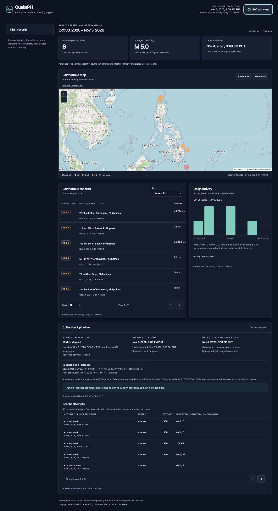
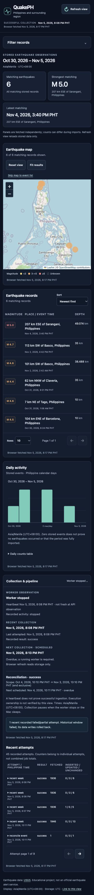
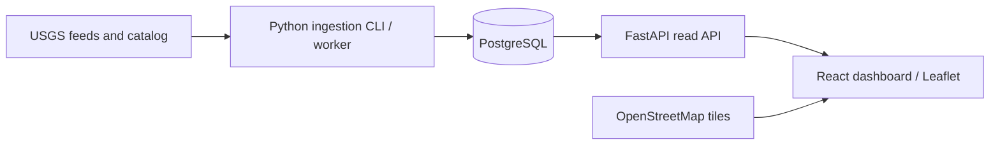

# QuakePH

A working earthquake data pipeline and interactive dashboard for **Philippines
and surrounding region**. Collect real USGS events, backfill older dates, resume
unfinished imports, track source revisions, and explore stored data on a map.

Coverage is a configurable **bounding box** (latitude 4–22°, longitude 116–130°),
including nearby waters. It is not an exact national boundary. Stored records do
not establish complete earthquake coverage. **Educational project; not an
official earthquake alert service.**



<details><summary>Mobile screenshot</summary>

</details>

## Architecture



| Component | Purpose |
| --- | --- |
| Python + httpx | Fetch, validate, normalize, and retry source requests |
| PostgreSQL | Persist events, checkpoints, revisions, schedules, and attempts |
| SQLAlchemy + Alembic | Transactional database access and versioned schema migrations |
| FastAPI | Validated, typed, read-only dashboard endpoints |
| React + TypeScript + Vite | Shared filters, URL navigation, independent panel loading |
| Leaflet | Interactive map with magnitude markers and source-linked details |
| Docker Compose | Local PostgreSQL with a persistent named volume |
| pytest + Vitest | Backend/PostgreSQL and frontend regression checks |

## Local installation

Use Docker Desktop with **Engine running**, Python 3.9+ for bootstrapping uv,
and Node **22.13+ in the 22 line, or 24+** (Node 24 LTS recommended). The application uses Python 3.12
(`backend/.python-version`; project supports >=3.12,<3.14). Keep both lockfiles.
Verified versions: Python 3.12.16, uv 0.13.6, Node 25.9.0, npm 11.12.1,
Docker Engine 29.4.1, PostgreSQL 17. See [verification](docs/VERIFICATION.md).

```sh
git clone https://github.com/ragna0112/QuakePH.git
cd QuakePH
python3 -m venv .tools
.tools/bin/python -m pip install uv==0.13.6
.tools/bin/uv python install 3.12
[ -f .env ] || cp .env.example .env
.tools/bin/uv sync --directory backend --locked
(cd frontend && npm ci)
docker compose up -d --wait
.tools/bin/uv run --directory backend --locked alembic upgrade head
.tools/bin/uv run --directory backend --locked alembic current
```

Run from the repository root in three separate terminals:

```sh
# 1. Read API
.tools/bin/uv run --directory backend --locked uvicorn app.main:app --host 127.0.0.1 --port 8001
```

```sh
# 2. Dashboard
(cd frontend && npm run dev)
```

```sh
# 3. Collector (optional for viewing existing data)
.tools/bin/uv run --directory backend --locked python -m app.worker
```

Open [dashboard](http://127.0.0.1:5174) and [API docs](http://127.0.0.1:8001/docs).
API port **8001** avoids an unrelated application on 8000; frontend uses **5174**;
PostgreSQL is loopback-bound on **55432**. Do not stop unrelated applications.

Stop API/frontend/worker with Ctrl+C. The worker stops at a safe boundary;
collection pauses when it stops or the Mac sleeps. Existing stored data remains
readable while the worker is stopped. `docker compose down` preserves the named
volume. Never use `docker compose down -v` if you need the stored data.

### Environment and production-build preview

Private root `.env` contains `DATABASE_URL`, matching `POSTGRES_*` values and
port 55432. URL-encode special characters in URL credentials. Initialization
settings apply only when the database volume is created; changing `.env` does
not change an existing user's password. The example password is for local use.
Bounds and worker settings are described in `.env.example`.

Vite forwards `/api` and `/health` to `http://127.0.0.1:8001`. Optional public
frontend settings are in `frontend/.env.example`; use ignored
`frontend/.env.local` and restart/rebuild after edits. `VITE_API_BASE_URL` can
select another backend origin, which also needs backend CORS configuration.
Never put credentials in `VITE_*` variables. `FRONTEND_ORIGINS` is a JSON array
of permitted direct browser origins; the same-origin proxy needs no extra origin.

```sh
(cd frontend && npm run build)
(cd frontend && npm run preview -- --host 127.0.0.1 --port 4174 --strictPort)
```

Open [production-build preview](http://127.0.0.1:4174). Vite preview **inherits the
configured API proxy**, verified against the real API. It is a local verification
server, not a public-hosting setup. Public hosting has not been verified.

## Import and reconcile

```sh
# Real rolling-week feed; repeat safely
.tools/bin/uv run --directory backend --locked python -m app.ingestion

# Backfill seven UTC days: start inclusive, end exclusive
.tools/bin/uv run --directory backend --locked python -m app.historical import --start 2020-01-01 --end 2020-01-08 --window-days 1
.tools/bin/uv run --directory backend --locked python -m app.historical resume JOB_ID

# Re-fetch a bounded catalog range and recheck previously stored IDs
.tools/bin/uv run --directory backend --locked python -m app.reconcile import --start 2020-01-01 --end 2020-01-08
.tools/bin/uv run --directory backend --locked python -m app.reconcile resume RECONCILIATION_ID
```

Replace IDs with the printed UUIDs. CLI date-only inputs mean **UTC midnight**,
with internal **[start, end)** bounds. An already completed resume reports prior
progress; start a new import/reconciliation to refresh that range.

The worker defaults to recent collection every 300 seconds and reconciliation
every 86,400 seconds over a 30-day interval. Intervals run from completed attempts;
failures use a bounded retry delay. Persistent schedules preserve due times across
restarts. The optional `--max-tasks 1` runs one due attempted task and exits cleanly.

### Storage and reliability

- `earthquakes`: USGS ID primary key, source/event UTC timestamps, nullable source
  fields, coordinates/depth, first/last seen, latest accepted raw JSON, source and
  coverage state. GeoJSON order is **longitude, latitude, depth (km)**.
- `pipeline_runs`: each attempt, timestamps/status, scope, counters, request
  failures, and bounded useful error details. Errors survive event rollback.
- `import_jobs` / `import_windows`: saved settings, window tree, ownership, attempts,
  and completed checkpoints. A window's event writes and completion commit together.
- `revision_history`: compact tracked-field changes linked to their accepted run.
- `workers` / `scheduled_tasks`: heartbeats, recorded activity, due times and results.
- `reconciliations` / `reconciliation_events`: frozen scope and stored-ID checks.

The USGS ID and PostgreSQL conflict handling prevent duplicate rows, including
concurrent attempts. Only a **strictly newer source-updated timestamp** replaces
stored event content. Older/identical revisions leave it intact; first-seen stays
fixed while last-seen can advance. Missing events in rolling feeds are retained.

HTTP uses explicit timeouts (10s connect; 30s other phases) and at most three
attempts for transient failures, with bounded backoff/Retry-After. Permanent
client errors fail. Malformed records are recorded; partial runs are not called
successful. Historical windows reject/roll back any malformed record while keeping
previous checkpoints. A valid empty response can complete an empty window.

Catalog windows adaptively split at the 20,000-result cap, conservatively at or
above the limit. Requests include both endpoints; local filtering enforces
[start,end), with safe deduplication at shared boundaries. A saturated 1ms window
fails clearly. Catalog changes during requests prevent a guaranteed source snapshot.

**Backfill** collects older data. A **checkpoint** saves completed progress.
**Idempotency** means rerunning does not duplicate events. **Resume** skips completed
windows and retries unfinished work using the original saved settings.
PostgreSQL session advisory locks prevent same-job and scheduled-owner overlap;
recovery requires acquiring ownership, with tokens fencing stale executors.
Timestamps alone never prove a process abandoned its work.

Reconciliation is **bounded**, not a full-catalog audit. It rechecks saved IDs to
find moves outside the box, explicit newer deletions, or redirects. Missing or
unresolved responses are observations, not proof of deletion. Older events need
manual older-range reconciliation. No absent response causes a stored row deletion.

## Dashboard and API semantics

Apply shared date, magnitude, depth, and place-text filters. The default is the
latest seven **Philippine calendar days**, including today. The UI's inclusive end
becomes the next Manila midnight, passed to the API as an exclusive UTC instant;
conversion is independent of browser timezone. Timestamps display explicit
**PHT / Asia/Manila** labels. Import CLI dates instead use UTC days.

A filter change validates input, resets pagination, encodes applied values in the
URL, and requests map, list, and statistics with the same filters. Sorting/page
are table-specific. Reload, copied links, and back/forward restore state. Empty
ranges remain empty. Obsolete responses are ignored/aborted; panels fail
independently. Failed refreshes may show clearly labelled cached results for that
same request. Separate endpoints do not share one transaction snapshot.

| GET endpoint | Data |
| --- | --- |
| `/health/live`, `/health/ready` | Process health vs database connectivity (200/503) |
| `/api/config` | Coverage configuration |
| `/api/earthquakes` | Paginated/sorted stored events, total and applied filters |
| `/api/earthquakes/map` | Bounded GeoJSON, returned/total counts and truncation |
| `/api/earthquakes/{usgs_id}` | Details and bounded accepted revision history |
| `/api/stats` | Full matching summaries and bounded Manila daily series |
| `/api/pipeline/status` | Recorded workers, schedules, reconciliation, failures |
| `/api/pipeline/runs` | Paginated attempt counters/errors |

See `/docs` for exact parameters. API `start` is inclusive and `end` exclusive;
use timezone-aware datetimes. Active, inside-box events are the default. Lists
allow at most 100/page; the UI map requests 1,000 (API maximum 5,000). Daily charts
cap at 366 days, history at 20 revisions. Truncated map/history and chart exclusions
are labelled; the list remains available. Statistics never derive from a table
page or limited map. Zero counts do not establish complete source coverage.

**Refresh view reads storage only**. It does not ingest or start a worker. Browser
fetch time differs from successful collection time. Fresh heartbeats indicate
recent process observation, not ingestion success or confirmed execution ownership.
Event dialogs support keyboard/Escape/focus restoration; chart values have a table.

## Inspect and test

```sh
curl -i http://127.0.0.1:8001/health/live
curl -i http://127.0.0.1:8001/health/ready
docker compose exec db sh -c 'psql -U "$POSTGRES_USER" -d "$POSTGRES_DB"'
```

```sql
SELECT usgs_id, event_time, magnitude, place, source_updated_at
FROM earthquakes ORDER BY event_time DESC LIMIT 10;
SELECT id, ingestion_type, started_at, status, fetched, inserted, updated,
       unchanged, rejected, failed_request_attempts FROM pipeline_runs
ORDER BY started_at DESC LIMIT 10;
SELECT id, status, start_at, end_at, executions FROM import_jobs;
SELECT job_id, start_at, end_at, status, attempts, counters FROM import_windows;
SELECT usgs_id, count(*) FROM earthquakes GROUP BY usgs_id HAVING count(*) > 1;
```

```sh
.tools/bin/uv run --directory backend --locked pytest --postgres
.tools/bin/uv run --directory backend --locked alembic check
(cd frontend && npm test)
(cd frontend && npm run test:other-tz)
(cd frontend && npm run typecheck && npm run lint && npm run build)
```

PostgreSQL tests create disposable `quakeph_test_<uuid>` schemas and remove only
their own data; the configured user needs CREATE SCHEMA permission. Without
`--postgres`, database integration tests skip. Never clear application tables.

## Verification, attribution, and limits

Milestone 7: **135 backend tests**, **29 frontend tests in each of two timezones**,
fresh-database migrations/schema checks, clean lockfile installs, build checks,
real feed/reimport/worker execution, and production-preview desktop/mobile checks
passed. Read-only UI checks left event/run counts unchanged. Detailed counts,
timestamps, caveats, and earlier evidence are in [VERIFICATION](docs/VERIFICATION.md).

Physical devices, screen-reader software, real browser timezone switching, and
public hosting remain unverified. Source revision/interruption failures were
proved with controlled tests, not fabricated production data or deliberate
upstream outages. There are no completeness or uptime guarantees. Current
limitations include bounded reconciliation/map/chart/history, independently fetched
panels, source changes during imports, and local-machine-dependent collection.

Earthquake data: [USGS weekly feed](https://earthquake.usgs.gov/earthquakes/feed/v1.0/summary/all_week.geojson),
[catalog documentation](https://earthquake.usgs.gov/fdsnws/event/1/),
[GeoJSON format](https://earthquake.usgs.gov/earthquakes/feed/v1.0/geojson.php).
Map: **© [OpenStreetMap contributors](https://www.openstreetmap.org/copyright)**,
standard raster tiles with visible attribution. Follow the
[official tile policy](https://operations.osmfoundation.org/policies/tiles/): normal
browser caching/referrer, no cache bypass, bulk download, or offline prefetch.
Tiles are best effort; failures leave the event list usable. Tile URL/attribution
are configurable in the public frontend environment.
Vite's [preview documentation](https://vite.dev/config/preview-options.html#preview-proxy)
confirms its inherited proxy behavior. Both policies were checked November 5, 2026.

Read the [student walkthrough](docs/WALKTHROUGH.md),
[portfolio wording](docs/PORTFOLIO.md), and
[historical milestone records](docs/MILESTONE_HISTORY.md).
Milestones 1–7 are complete locally. Nothing has been pushed or deployed.
